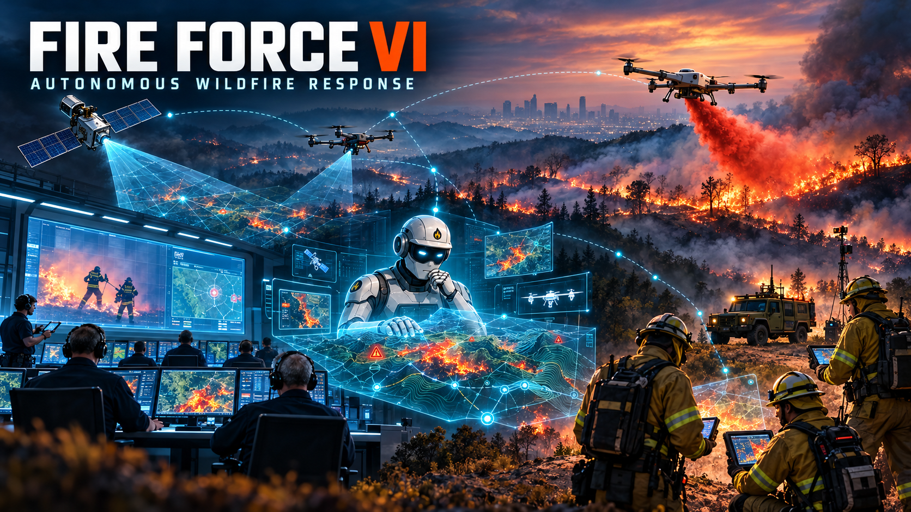

# Neurosymbolic Systems Engineering (NSEE)

**Course provider: Modelware.**

NSEE teaches you to capture engineering knowledge as formal models, verify it with automated reasoning, ground AI agents in that knowledge, and deliver reproducible engineering products.

The course combines **ontological modeling, automated reasoning, generative AI, and model DevOps**. OML Code is the working environment. Sierra Method and the Fire Force VI system are the shared running example; you develop your own methodology and system model alongside it.

## Start here

1. Read the [course guide](instructions/CourseGuide.md) for prerequisites, access, evidence, and review arrangements.
2. Complete [Module 1](instructions/Module1.md) to prepare your tools and define your engineering questions.
3. Follow the eight modules in order. Each lab practices the shared example; the [capstone roadmap](instructions/CapstoneRoadmap.md) applies the same techniques to your own system.

## Modules

| Module | Topic | Practical work |
| --- | --- | --- |
| [1](instructions/Module1.md) | Foundations | Tool setup; scope, stakeholders, and engineering questions |
| [2](instructions/Module2.md) | Representation I: The Basics of OML | Vocabularies and system descriptions |
| [3](instructions/Module3.md) | Representation II: Reasoning over OML | Entailments, constraints, and reasoning experiments |
| [4](instructions/Module4.md) | Methodology I: Patterns and Authoring | Patterns, editors, validation, and reusable templates |
| [5](instructions/Module5.md) | Methodology II: Queries, Views, and Analyses | SPARQL, dashboards, computed analysis, and findings |
| [6](instructions/Module6.md) | Neurosymbolic Loop: AI in the Methodology | Grounded agents, MCP, skills, verification, and repair |
| [7](instructions/Module7.md) | Generation and Publishing | Generators, packages, registries, and independent consumers |
| [8](instructions/Module8.md) | Models at Scale: Versions, Federation, CI/CD | Controlled change, integration checks, and a traceable capstone release |

## Running example: Sierra Method and Fire Force VI

Lectures, demonstrations, and labs use **Sierra Method** to model **Fire Force VI**, an autonomous wildfire-response system. This shared example shows how the course techniques fit together.



## Your capstone project

**Choose your own engineering system and domain.** Define its scope, stakeholders, and engineering questions in Module 1, then develop your own methodology and system model throughout the course. Apply the techniques practiced with Sierra and Fire Force VI to your chosen project.

The capstone has five cumulative project increments:

| Project | Modules |
| --- | --- |
| Project 1 | 1 |
| Project 2 | 2–3 |
| Project 3 | 4–5 |
| Project 4 | 6 |
| Project 5 | 7–8 |

See the [capstone roadmap](instructions/CapstoneRoadmap.md) for outcomes and module-relative submission points.

By the end, your capstone connects those engineering questions to a versioned model, an explicit methodology, verified analysis, AI-assisted work, and generated products. You release a reproducible version `1.0.0` with evidence showing what was checked and how each original question was answered or why a gap remains.

## Submissions

Email lab and capstone submissions directly to the lecturer, **Dr Maged Elaasar**, at [melaasar@modelware.io](mailto:melaasar@modelware.io). Each module lists the required evidence.

## Resources

| Resource | Link |
| --- | --- |
| Modelware Academy | https://academy.modelware.io/ |
| OML Code | https://www.modelware.io/oml-code |
| OML Language Specification | https://opencaesar.io/oml/ |
| OML Tutorials | https://opencaesar.io/oml-tutorials/ |
| OML overview paper | https://www.modelware.io/assets/papers/iswc-2026-oml-semantic-web-mbse.pdf |
| Sierra Method running example | https://github.com/modelware/sierra-method |
| Independent consumer example | https://github.com/modelware/sierra-example |
| Local package registry | https://github.com/modelware/verdaccio |
| openCAESAR | https://opencaesar.io/ |
| OWL 2 Primer | https://www.w3.org/TR/owl2-primer/ |
| SHACL | https://www.w3.org/TR/shacl/ |

## Using this repository

Clone the course instructions with:

```bash
git clone https://github.com/modelware/neurosymbolic-se.git
```

Work in your own Sierra fork for labs and in separate repositories for your capstone. Course videos and slides are supplied through the Modelware NSEE course.

For access or course help, use Modelware’s course support channel or [contact Modelware](https://www.modelware.io/contact).
